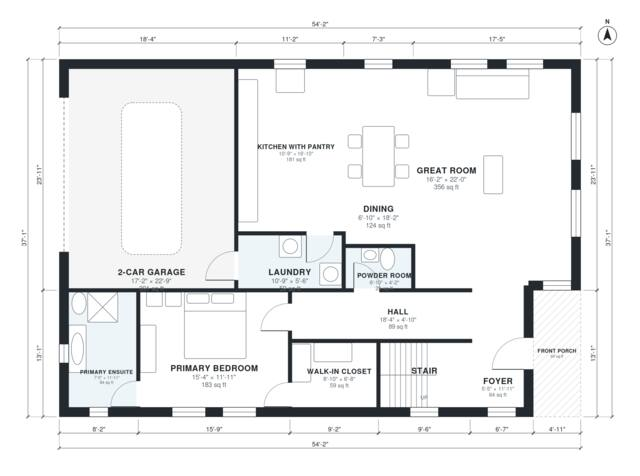

# 1.5 Story House Plans: 3 Bed, 2.5 Bath, 2,280 Sq Ft Plan

This 1.5-story modern farmhouse has about 2,250 sq ft of living space, plus a 2-car garage and a front porch. The main floor has the primary suite with walk-in closet and ensuite, an open great room, dining and kitchen, a powder room and laundry. Upstairs are two bedrooms, a full bath and a loft. The revision gives the upstairs bath and dining area more usable proportions.

| | |
|---|---|
| Levels | 2 |
| Footprint | 16.5 m × 11.3 m (54 ft × 37 ft) |
| Rooms | 18 indoor, 2 outdoor |
| Indoor area including garage, from the room grid | about 253 m² (2,721 sq ft) |

## Files here

- `building.json` (rooms, walls, openings as data)
- `plan-level1.dxf` (floor plan, DXF, drawing units: inches)
- `plan-level2.dxf` (floor plan, DXF, drawing units: inches)

## More for this plan

- Plan page with the PDF plan set, IFC and 3D model, and a tool to change the plan: https://floorplan.ai-architectures.com/house-plans/1-5-story-house-plans?utm_source=github-plans&utm_medium=probe&utm_campaign=github
- PDF plan set: https://storage.googleapis.com/20img/house-plans/1-5-story-house-plans/plan-set.pdf
- IFC model: https://storage.googleapis.com/20img/house-plans/1-5-story-house-plans/model.ifc

## Known issues in this drawing

- Foyer is 6.0 m² (asked for about 8.0 m²).
- Dining is only 2.08 m wide.
- Bath is only 1.68 m wide.
- Loft is only 3.14 m wide.

Concept design generated with AI. Not for construction or permit; verify with a licensed professional.
