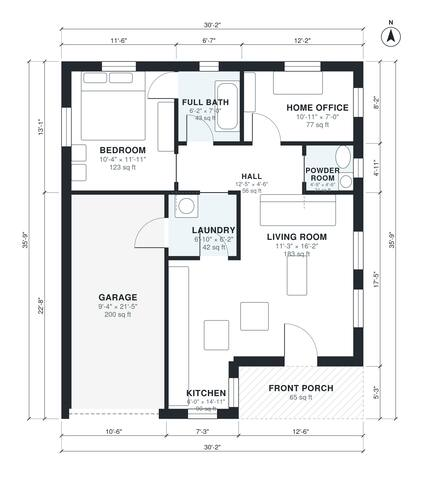

# 1 Bedroom 1.5 Bath House Plans: 780 Sq Ft Single Story

A compact single-story 1-bedroom, 1.5-bath cottage of about 88 m² (950 sq ft) of living space. It has an open kitchen and living room, a home office, laundry, powder room and a front porch. The 1-car garage is extra and enters through the laundry. The revision enlarges the hall so the home office gets a proper door off it.

| | |
|---|---|
| Levels | 1 |
| Footprint | 9.2 m × 10.9 m (30 ft × 36 ft) |
| Rooms | 9 indoor, 1 outdoor |
| Indoor area including garage, from the room grid | about 94 m² (1,014 sq ft) |

## Files here

- `area-schedule.csv` (room schedule)
- `building.json` (rooms, walls, openings as data)
- `plan-level1.dxf` (floor plan, DXF, drawing units: inches)

## More for this plan

- Plan page with the PDF plan set, IFC and 3D model, and a tool to change the plan: https://floorplan.ai-architectures.com/house-plans/1-bedroom-1-5-bath-house-plans?utm_source=github-plans&utm_medium=probe&utm_campaign=github
- PDF plan set: https://storage.googleapis.com/20img/house-plans/1-bedroom-1-5-bath-house-plans/plan-set.pdf
- IFC model: https://storage.googleapis.com/20img/house-plans/1-bedroom-1-5-bath-house-plans/model.ifc

## Known issues in this drawing

- Kitchen is only 1.84 m wide.

Concept design generated with AI. Not for construction or permit; verify with a licensed professional.
