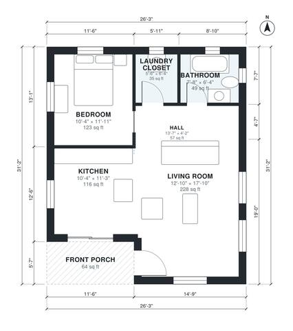

# 1 Bedroom 1 Bath House Plans: 750 Sq Ft Single-Story Layout

This is a compact single-story cottage of about 70 m² (750 sq ft) of living space, plus a 6 m² covered front porch. The porch leads into an open living room and kitchen. A short hall at the back serves the bedroom, full bath and laundry closet, which keeps the sleeping area fairly private. There is no garage, as requested.

| | |
|---|---|
| Levels | 1 |
| Footprint | 8.0 m × 9.5 m (26 ft × 31 ft) |
| Rooms | 6 indoor, 1 outdoor |
| Indoor area including garage, from the room grid | about 70 m² (754 sq ft) |

## Files here

- `area-schedule.csv` (room schedule)
- `building.json` (rooms, walls, openings as data)
- `plan-level1.dxf` (floor plan, DXF, drawing units: inches)

## More for this plan

- Plan page with the PDF plan set, IFC and 3D model, and a tool to change the plan: https://floorplan.ai-architectures.com/house-plans/1-bedroom-1-bath-house-plans?utm_source=github-plans&utm_medium=probe&utm_campaign=github
- PDF plan set: https://storage.googleapis.com/20img/house-plans/1-bedroom-1-bath-house-plans/plan-set.pdf
- IFC model: https://storage.googleapis.com/20img/house-plans/1-bedroom-1-bath-house-plans/model.ifc

## Known issues in this drawing

- None found by the automatic checks.

Concept design generated with AI. Not for construction or permit; verify with a licensed professional.
