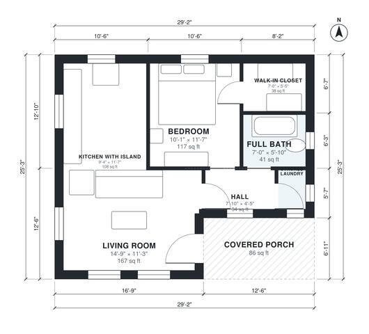

# 1 Bedroom ADU Plans: 650 Sq Ft Detached Backyard Unit

This is a compact detached 1-bedroom ADU of about 650 sq ft (60 m²) of living space, plus a covered porch of about 86 sq ft. The porch opens into an open living room and kitchen with an island. A short hall serves the bedroom with its walk-in closet, the full bath and a stacked laundry closet. The layout is efficient and keeps the bedroom private.

| | |
|---|---|
| Levels | 1 |
| Footprint | 8.9 m × 7.7 m (29 ft × 25 ft) |
| Rooms | 7 indoor, 1 outdoor |
| Indoor area including garage, from the room grid | about 61 m² (652 sq ft) |

## Files here

- `area-schedule.csv` (room schedule)
- `building.json` (rooms, walls, openings as data)
- `plan-level1.dxf` (floor plan, DXF, drawing units: inches)

## More for this plan

- Plan page with the PDF plan set, IFC and 3D model, and a tool to change the plan: https://floorplan.ai-architectures.com/house-plans/1-bedroom-adu-plans?utm_source=github-plans&utm_medium=probe&utm_campaign=github
- PDF plan set: https://storage.googleapis.com/20img/house-plans/1-bedroom-adu-plans/plan-set.pdf
- IFC model: https://storage.googleapis.com/20img/house-plans/1-bedroom-adu-plans/model.ifc

## Known issues in this drawing

- None found by the automatic checks.

Concept design generated with AI. Not for construction or permit; verify with a licensed professional.
