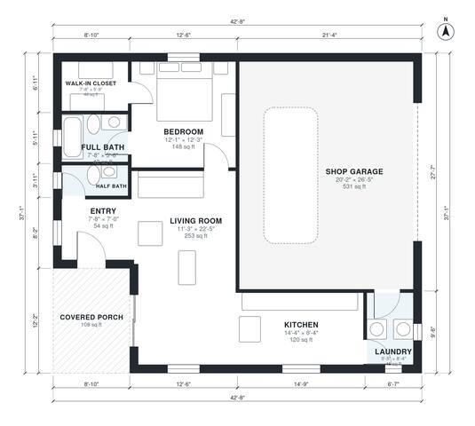

# 1 Bedroom Barndominium Floor Plans: 890 Sq Ft + Shop Garage

This is a compact one-bedroom barndominium of about 147 m² (1,580 sq ft) under one roof. It has about 70 m² (750 sq ft) of conditioned living space, a 49 m² (531 sq ft) attached shop garage, and a covered front porch. The open kitchen and living area gets daylight from the south and west. The bedroom suite with walk-in closet and full bath is in the quiet northwest corner. A half bath is by the entry, and the laundry doubles as a mudroom between the kitchen and the garage.

| | |
|---|---|
| Levels | 1 |
| Footprint | 13.0 m × 11.3 m (43 ft × 37 ft) |
| Rooms | 9 indoor, 1 outdoor |
| Indoor area including garage, from the room grid | about 137 m² (1,474 sq ft) |

## Files here

- `area-schedule.csv` (room schedule)
- `building.json` (rooms, walls, openings as data)
- `plan-level1.dxf` (floor plan, DXF, drawing units: inches)

## More for this plan

- Plan page with the PDF plan set, IFC and 3D model, and a tool to change the plan: https://floorplan.ai-architectures.com/house-plans/1-bedroom-barndominium-floor-plans?utm_source=github-plans&utm_medium=probe&utm_campaign=github
- PDF plan set: https://storage.googleapis.com/20img/house-plans/1-bedroom-barndominium-floor-plans/plan-set.pdf
- IFC model: https://storage.googleapis.com/20img/house-plans/1-bedroom-barndominium-floor-plans/model.ifc

## Known issues in this drawing

- Entry is 5.0 m² (asked for about 7.0 m²).
- Full Bath is 3.9 m² (asked for about 6.0 m²).

Concept design generated with AI. Not for construction or permit; verify with a licensed professional.
