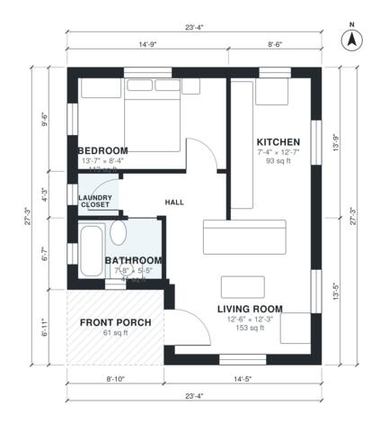

# 1 Bedroom Cottage House Plans: 570 Sq Ft Single-Story Plan

This is a compact single-story cottage of about 59 m² (roughly 635 sq ft) including a covered front porch. The porch leads into an open living and kitchen space, and a short hall serves the bedroom, full bath and laundry closet. It is simple and efficient, with good daylight and no garage, as requested.

| | |
|---|---|
| Levels | 1 |
| Footprint | 7.1 m × 8.3 m (23 ft × 27 ft) |
| Rooms | 6 indoor, 1 outdoor |
| Indoor area including garage, from the room grid | about 53 m² (573 sq ft) |

## Files here

- `area-schedule.csv` (room schedule)
- `building.json` (rooms, walls, openings as data)
- `plan-level1.dxf` (floor plan, DXF, drawing units: inches)

## More for this plan

- Plan page with the PDF plan set, IFC and 3D model, and a tool to change the plan: https://floorplan.ai-architectures.com/house-plans/1-bedroom-cottage-house-plans?utm_source=github-plans&utm_medium=probe&utm_campaign=github
- PDF plan set: https://storage.googleapis.com/20img/house-plans/1-bedroom-cottage-house-plans/plan-set.pdf
- IFC model: https://storage.googleapis.com/20img/house-plans/1-bedroom-cottage-house-plans/model.ifc

## Known issues in this drawing

- Laundry Closet is only 1.14 m wide.

Concept design generated with AI. Not for construction or permit; verify with a licensed professional.
