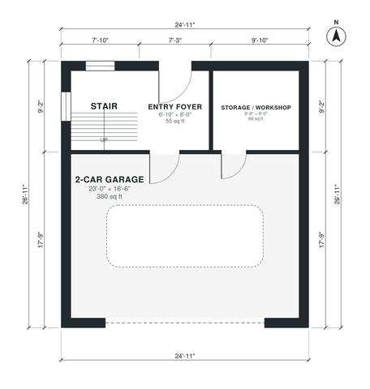

# 1 Bedroom Garage Apartment Plans: 900 Sq Ft, 2-Car Garage

This is a compact two-story garage apartment on a 7.6 x 8.2 m footprint, about 62 m² per floor. The ground floor has a 2-car garage, a storage/workshop room, an entry foyer and the stair. Upstairs is a roughly 600 sq ft one-bedroom apartment with an open kitchen and living area, a full bath, a laundry closet and a bedroom closet. The kitchen came out a little smaller than requested, which we can rebalance if you want a larger one.

| | |
|---|---|
| Levels | 2 |
| Footprint | 7.6 m × 8.2 m (25 ft × 27 ft) |
| Rooms | 12 indoor, 0 outdoor |
| Indoor area including garage, from the room grid | about 125 m² (1,342 sq ft) |

## Files here

- `area-schedule.csv` (room schedule)
- `building.json` (rooms, walls, openings as data)
- `plan-level1.dxf` (floor plan, DXF, drawing units: inches)
- `plan-level2.dxf` (floor plan, DXF, drawing units: inches)

## More for this plan

- Plan page with the PDF plan set, IFC and 3D model, and a tool to change the plan: https://floorplan.ai-architectures.com/house-plans/1-bedroom-garage-apartment-plans?utm_source=github-plans&utm_medium=probe&utm_campaign=github
- PDF plan set: https://storage.googleapis.com/20img/house-plans/1-bedroom-garage-apartment-plans/plan-set.pdf
- IFC model: https://storage.googleapis.com/20img/house-plans/1-bedroom-garage-apartment-plans/model.ifc

## Known issues in this drawing

- None found by the automatic checks.

Concept design generated with AI. Not for construction or permit; verify with a licensed professional.
