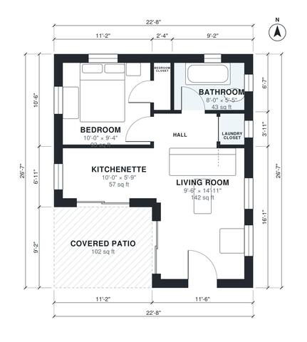

# 1 Bedroom Guest House Plans: 500 Sq Ft Backyard Cottage

This is a compact one-bedroom backyard guest house of about 500 sq ft of conditioned space, plus a 102 sq ft covered patio. The living room is open to the kitchenette and has French doors to the patio. A short hall leads to the bedroom with its closet, the bathroom and a laundry closet.

| | |
|---|---|
| Levels | 1 |
| Footprint | 6.9 m × 8.1 m (23 ft × 27 ft) |
| Rooms | 7 indoor, 1 outdoor |
| Indoor area including garage, from the room grid | about 46 m² (499 sq ft) |

## Files here

- `area-schedule.csv` (room schedule)
- `building.json` (rooms, walls, openings as data)
- `plan-level1.dxf` (floor plan, DXF, drawing units: inches)

## More for this plan

- Plan page with the PDF plan set, IFC and 3D model, and a tool to change the plan: https://floorplan.ai-architectures.com/house-plans/1-bedroom-guest-house-plans?utm_source=github-plans&utm_medium=probe&utm_campaign=github
- PDF plan set: https://storage.googleapis.com/20img/house-plans/1-bedroom-guest-house-plans/plan-set.pdf
- IFC model: https://storage.googleapis.com/20img/house-plans/1-bedroom-guest-house-plans/model.ifc

## Known issues in this drawing

- Kitchenette is only 1.74 m wide.
- Living Room is only 2.90 m wide.

Concept design generated with AI. Not for construction or permit; verify with a licensed professional.
