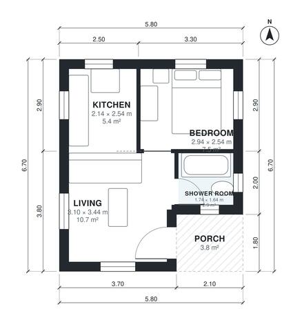

# 1 Bedroom House Plans 35 m2: 380 Sq Ft Single-Story Plan

This is a compact single-storey house with an open kitchen and living area at the entrance, one bedroom, a shower room and a small covered porch. After the revision the indoor living space is about 35 m², plus a 5.8 m² porch. The widened bedroom and shower room give better proportions, and there is no garage or basement.

| | |
|---|---|
| Levels | 1 |
| Footprint | 5.8 m × 6.7 m (19 ft × 22 ft) |
| Rooms | 4 indoor, 1 outdoor |
| Indoor area including garage, from the room grid | about 35 m² (378 sq ft) |

## Files here

- `area-schedule.csv` (room schedule)
- `building.json` (rooms, walls, openings as data)
- `plan-level1.dxf` (floor plan, DXF, drawing units: millimetres)

## More for this plan

- Plan page with the PDF plan set, IFC and 3D model, and a tool to change the plan: https://floorplan.ai-architectures.com/house-plans/1-bedroom-house-plan-35-m2?utm_source=github-plans&utm_medium=probe&utm_campaign=github
- PDF plan set: https://storage.googleapis.com/20img/house-plans/1-bedroom-house-plan-35-m2/plan-set.pdf
- IFC model: https://storage.googleapis.com/20img/house-plans/1-bedroom-house-plan-35-m2/model.ifc

## Known issues in this drawing

- Shower Room is 2.9 m² (asked for about 4.5 m²).
- Bedroom is only 2.54 m wide.

Concept design generated with AI. Not for construction or permit; verify with a licensed professional.
