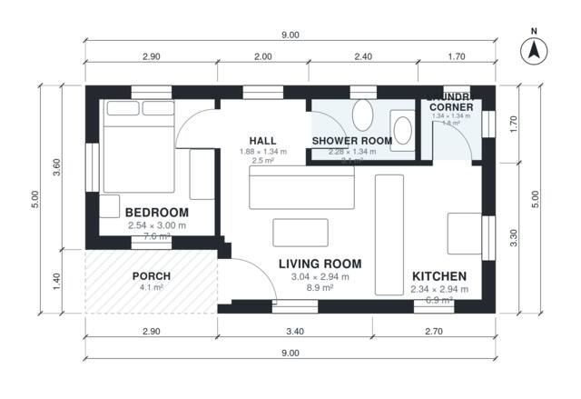

# 1 Bedroom House Plan 40 m2: 440 Sq Ft Single-Story Layout

This is a compact single-storey home of about 41 m² of living space, plus a 4 m² covered porch at the front. You enter from the porch into an open living and kitchen area. The bedroom and the shower room open directly off the living room, and a small laundry corner sits beside the kitchen. Natural light comes from windows on every side. The bedroom, shower room and laundry are tight, so a slightly larger footprint would give more room if you want it.

| | |
|---|---|
| Levels | 1 |
| Footprint | 9.0 m × 5.0 m (30 ft × 16 ft) |
| Rooms | 6 indoor, 1 outdoor |
| Indoor area including garage, from the room grid | about 41 m² (441 sq ft) |

## Files here

- `area-schedule.csv` (room schedule)
- `building.json` (rooms, walls, openings as data)
- `plan-level1.dxf` (floor plan, DXF, drawing units: millimetres)

## More for this plan

- Plan page with the PDF plan set, IFC and 3D model, and a tool to change the plan: https://floorplan.ai-architectures.com/house-plans/1-bedroom-house-plan-40-m2?utm_source=github-plans&utm_medium=probe&utm_campaign=github
- PDF plan set: https://storage.googleapis.com/20img/house-plans/1-bedroom-house-plan-40-m2/plan-set.pdf
- IFC model: https://storage.googleapis.com/20img/house-plans/1-bedroom-house-plan-40-m2/model.ifc

## Known issues in this drawing

- Bedroom is only 2.54 m wide.
- Living Room is 8.9 m² (asked for about 14.0 m²).

Concept design generated with AI. Not for construction or permit; verify with a licensed professional.
