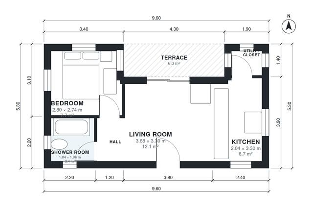

# 1 Bedroom House Plan 45 m2: 480 Sq Ft Single-Story Home

A compact single-storey home of about 45 m² of living space plus a 6 m² covered terrace, in a 9.6 x 5.3 m envelope with no garage or basement. The front door opens into an open living room and kitchen with a sliding door to the terrace. A short hall serves the bedroom and the shower room, and a utility closet sits off the kitchen. Bedroom, shower room and kitchen are tighter than the original targets, and we can rebalance them if you want more space in any of them.

| | |
|---|---|
| Levels | 1 |
| Footprint | 9.6 m × 5.3 m (31 ft × 17 ft) |
| Rooms | 6 indoor, 1 outdoor |
| Indoor area including garage, from the room grid | about 45 m² (483 sq ft) |

## Files here

- `area-schedule.csv` (room schedule)
- `building.json` (rooms, walls, openings as data)
- `plan-level1.dxf` (floor plan, DXF, drawing units: millimetres)

## More for this plan

- Plan page with the PDF plan set, IFC and 3D model, and a tool to change the plan: https://floorplan.ai-architectures.com/house-plans/1-bedroom-house-plan-45-m2?utm_source=github-plans&utm_medium=probe&utm_campaign=github
- PDF plan set: https://storage.googleapis.com/20img/house-plans/1-bedroom-house-plan-45-m2/plan-set.pdf
- IFC model: https://storage.googleapis.com/20img/house-plans/1-bedroom-house-plan-45-m2/model.ifc

## Known issues in this drawing

- Bedroom is 7.7 m² (asked for about 10.5 m²).
- Utility Closet is only 1.04 m wide.

Concept design generated with AI. Not for construction or permit; verify with a licensed professional.
