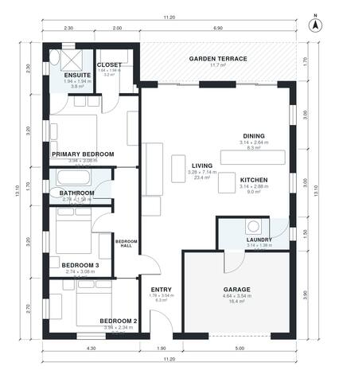

# 10 Meter Wide House Plans: 3 Bed, 2 Bath, 1,240 Sq Ft

A compact single-storey house on a 10 m wide plot, with about 115 m² of living space plus a 1-car garage and a garden terrace. The open kitchen, dining and living area runs down one side and opens to the terrace. The three bedrooms and two baths sit in a private wing off a central hall, and the garage connects through the laundry. Dining, ensuite and closet are on the snug side, which we can adjust if you want them roomier.

| | |
|---|---|
| Levels | 1 |
| Footprint | 11.2 m × 13.1 m (37 ft × 43 ft) |
| Rooms | 13 indoor, 1 outdoor |
| Indoor area including garage, from the room grid | about 135 m² (1,453 sq ft) |

## Files here

- `area-schedule.csv` (room schedule)
- `building.json` (rooms, walls, openings as data)
- `plan-level1.dxf` (floor plan, DXF, drawing units: millimetres)

## More for this plan

- Plan page with the PDF plan set, IFC and 3D model, and a tool to change the plan: https://floorplan.ai-architectures.com/house-plans/10-meter-wide-house-plans?utm_source=github-plans&utm_medium=probe&utm_campaign=github
- PDF plan set: https://storage.googleapis.com/20img/house-plans/10-meter-wide-house-plans/plan-set.pdf
- IFC model: https://storage.googleapis.com/20img/house-plans/10-meter-wide-house-plans/model.ifc

## Known issues in this drawing

- Bedroom 2 is only 2.34 m wide.

Concept design generated with AI. Not for construction or permit; verify with a licensed professional.
