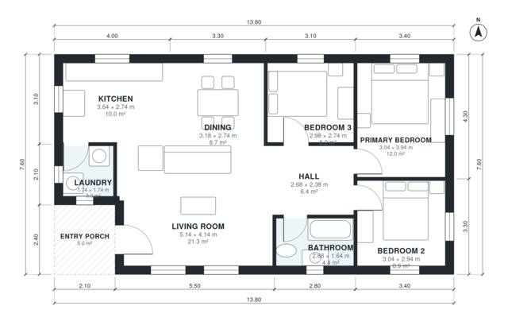

# 100 Square Meter House Plans: 3-Bed, 1,070 Sq Ft Single Story

This is a compact single-story home of about 105 m² including the 5 m² entry porch, with a 13.8 x 7.6 m footprint and no garage. The front door opens into a bright open kitchen, dining and living area. A central hall leads to three bedrooms and a shared bath on the quiet east side, and the laundry is tucked off the kitchen.

| | |
|---|---|
| Levels | 1 |
| Footprint | 13.8 m × 7.6 m (45 ft × 25 ft) |
| Rooms | 9 indoor, 1 outdoor |
| Indoor area including garage, from the room grid | about 100 m² (1,075 sq ft) |

## Files here

- `area-schedule.csv` (room schedule)
- `building.json` (rooms, walls, openings as data)
- `plan-level1.dxf` (floor plan, DXF, drawing units: millimetres)

## More for this plan

- Plan page with the PDF plan set, IFC and 3D model, and a tool to change the plan: https://floorplan.ai-architectures.com/house-plans/100-square-meter-house-plans?utm_source=github-plans&utm_medium=probe&utm_campaign=github
- PDF plan set: https://storage.googleapis.com/20img/house-plans/100-square-meter-house-plans/plan-set.pdf
- IFC model: https://storage.googleapis.com/20img/house-plans/100-square-meter-house-plans/model.ifc

## Known issues in this drawing

- Laundry is 3.0 m² (asked for about 4.5 m²).

Concept design generated with AI. Not for construction or permit; verify with a licensed professional.
