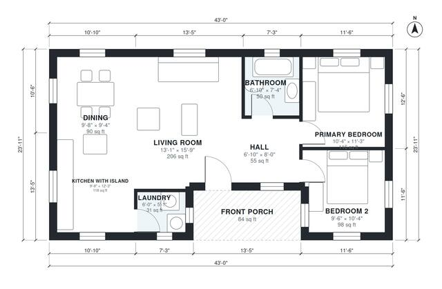

# 1000 Sq Ft 2 Bedroom House Plans: 950 Sq Ft, 1 Bath Layout

This is a compact single-story 2-bedroom, 1-bath home of about 95 m² (roughly 1,030 sq ft including the 84 sq ft front porch). The kitchen with island, dining and living room form one bright open space. The two bedrooms and the bath are grouped off a short hall at the east end, and the laundry sits off the kitchen next to the covered front porch.

| | |
|---|---|
| Levels | 1 |
| Footprint | 13.1 m × 7.3 m (43 ft × 24 ft) |
| Rooms | 8 indoor, 1 outdoor |
| Indoor area including garage, from the room grid | about 88 m² (946 sq ft) |

## Files here

- `area-schedule.csv` (room schedule)
- `building.json` (rooms, walls, openings as data)
- `plan-level1.dxf` (floor plan, DXF, drawing units: inches)

## More for this plan

- Plan page with the PDF plan set, IFC and 3D model, and a tool to change the plan: https://floorplan.ai-architectures.com/house-plans/1000-sq-ft-2-bedroom-house-plans?utm_source=github-plans&utm_medium=probe&utm_campaign=github
- PDF plan set: https://storage.googleapis.com/20img/house-plans/1000-sq-ft-2-bedroom-house-plans/plan-set.pdf
- IFC model: https://storage.googleapis.com/20img/house-plans/1000-sq-ft-2-bedroom-house-plans/model.ifc

## Known issues in this drawing

- Laundry is 2.8 m² (asked for about 4.5 m²).

Concept design generated with AI. Not for construction or permit; verify with a licensed professional.
