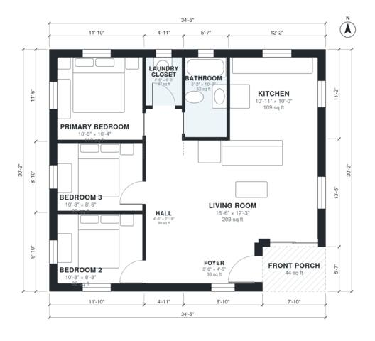

# 1000 Sq Ft 3 Bedroom House Plans: One-Story, 1 Bath Layout

This is a compact single-storey home of about 96 m² (roughly 1,000 sq ft of living space), plus a small covered front porch. The kitchen and living room form one bright open space. Three bedrooms, the bath and a laundry closet sit along the west side, off a central hall. It has no garage, as requested.

| | |
|---|---|
| Levels | 1 |
| Footprint | 10.5 m × 9.2 m (34 ft × 30 ft) |
| Rooms | 9 indoor, 1 outdoor |
| Indoor area including garage, from the room grid | about 93 m² (996 sq ft) |

## Files here

- `area-schedule.csv` (room schedule)
- `building.json` (rooms, walls, openings as data)
- `plan-level1.dxf` (floor plan, DXF, drawing units: inches)

## More for this plan

- Plan page with the PDF plan set, IFC and 3D model, and a tool to change the plan: https://floorplan.ai-architectures.com/house-plans/1000-sq-ft-3-bedroom-house-plans?utm_source=github-plans&utm_medium=probe&utm_campaign=github
- PDF plan set: https://storage.googleapis.com/20img/house-plans/1000-sq-ft-3-bedroom-house-plans/plan-set.pdf
- IFC model: https://storage.googleapis.com/20img/house-plans/1000-sq-ft-3-bedroom-house-plans/model.ifc

## Known issues in this drawing

- Foyer is 3.5 m² (asked for about 5.0 m²).

Concept design generated with AI. Not for construction or permit; verify with a licensed professional.
