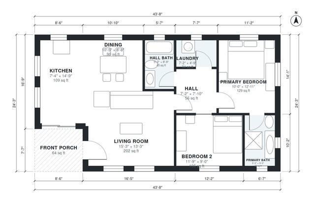

# 1000 Sq Ft ADU Plans: 2 Bed, 2 Bath Detached Backyard Unit

This is a single-storey backyard ADU of about 99 m² (roughly 1,060 sq ft) including the front porch, with about 995 sq ft of indoor living space. A porch leads into an open kitchen, dining and living area. A central hall connects a hall bath, the laundry and two bedrooms, and the primary bedroom has its own ensuite. The compact rectangular footprint is efficient and gets daylight on all sides.

| | |
|---|---|
| Levels | 1 |
| Footprint | 13.3 m × 7.4 m (44 ft × 24 ft) |
| Rooms | 9 indoor, 1 outdoor |
| Indoor area including garage, from the room grid | about 92 m² (995 sq ft) |

## Files here

- `area-schedule.csv` (room schedule)
- `building.json` (rooms, walls, openings as data)
- `plan-level1.dxf` (floor plan, DXF, drawing units: inches)

## More for this plan

- Plan page with the PDF plan set, IFC and 3D model, and a tool to change the plan: https://floorplan.ai-architectures.com/house-plans/1000-sq-ft-adu-plans?utm_source=github-plans&utm_medium=probe&utm_campaign=github
- PDF plan set: https://storage.googleapis.com/20img/house-plans/1000-sq-ft-adu-plans/plan-set.pdf
- IFC model: https://storage.googleapis.com/20img/house-plans/1000-sq-ft-adu-plans/model.ifc

## Known issues in this drawing

- None found by the automatic checks.

Concept design generated with AI. Not for construction or permit; verify with a licensed professional.
