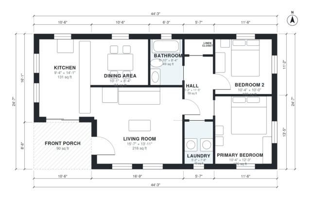

# 1000 sq ft House Plans: 2 Bed, 1 Bath Single-Level Design

This is a compact single-storey cottage of about 1,000 sq ft indoors, plus a front porch of roughly 90 sq ft. The front porch opens into an open living room, kitchen and dining area. A central hall serves two bedrooms, a full bath, a laundry and a linen closet.

| | |
|---|---|
| Levels | 1 |
| Footprint | 13.5 m × 7.5 m (44 ft × 25 ft) |
| Rooms | 9 indoor, 1 outdoor |
| Indoor area including garage, from the room grid | about 93 m² (1,000 sq ft) |

## Files here

- `building.json` (rooms, walls, openings as data)
- `plan-level1.dxf` (floor plan, DXF, drawing units: inches)

## More for this plan

- Plan page with the PDF plan set, IFC and 3D model, and a tool to change the plan: https://floorplan.ai-architectures.com/house-plans/1000-sq-ft-house-plans?utm_source=github-plans&utm_medium=probe&utm_campaign=github
- PDF plan set: https://storage.googleapis.com/20img/house-plans/1000-sq-ft-house-plans/plan-set.pdf
- IFC model: https://storage.googleapis.com/20img/house-plans/1000-sq-ft-house-plans/model.ifc

## Known issues in this drawing

- Dining Area is only 2.54 m wide.

Concept design generated with AI. Not for construction or permit; verify with a licensed professional.
