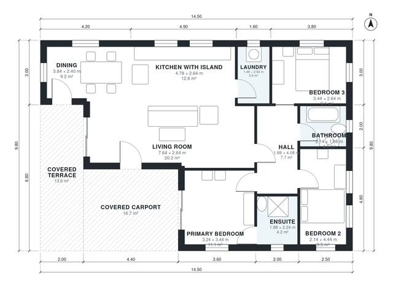

# 110 Square Meter House Plans: 3-Bed, 2-Bath One-Story Home

This is a compact single-storey home of about 110 m² of living space on a 14.5 x 9.8 m footprint, plus a covered carport and a covered terrace. The kitchen with island, dining and living areas form one open space that opens onto the rear terrace. Three bedrooms, including a primary with ensuite, and a family bathroom are grouped off a central hall.

| | |
|---|---|
| Levels | 1 |
| Footprint | 14.5 m × 9.8 m (48 ft × 32 ft) |
| Rooms | 10 indoor, 2 outdoor |
| Indoor area including garage, from the room grid | about 112 m² (1,203 sq ft) |

## Files here

- `area-schedule.csv` (room schedule)
- `building.json` (rooms, walls, openings as data)
- `plan-level1.dxf` (floor plan, DXF, drawing units: millimetres)

## More for this plan

- Plan page with the PDF plan set, IFC and 3D model, and a tool to change the plan: https://floorplan.ai-architectures.com/house-plans/110-square-meter-house-plans?utm_source=github-plans&utm_medium=probe&utm_campaign=github
- PDF plan set: https://storage.googleapis.com/20img/house-plans/110-square-meter-house-plans/plan-set.pdf
- IFC model: https://storage.googleapis.com/20img/house-plans/110-square-meter-house-plans/model.ifc

## Known issues in this drawing

- Living Room is only 2.64 m wide.
- Bedroom 2 is only 2.14 m wide.
- Dining is only 2.40 m wide.

Concept design generated with AI. Not for construction or permit; verify with a licensed professional.
