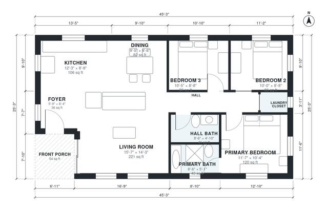

# 1100 Sq Ft 3 Bedroom House Plans: 2 Bath Single-Story

This is a compact single-storey ranch of about 106 m² (roughly 1,140 sq ft including the porch). A covered porch leads through a small foyer into an open kitchen, dining and living area with windows on three sides. Bedrooms 2 and 3, the hall bath, the laundry closet and the primary suite with its own bath are grouped on the east side of the plan.

| | |
|---|---|
| Levels | 1 |
| Footprint | 13.8 m × 7.7 m (45 ft × 25 ft) |
| Rooms | 11 indoor, 1 outdoor |
| Indoor area including garage, from the room grid | about 101 m² (1,090 sq ft) |

## Files here

- `area-schedule.csv` (room schedule)
- `building.json` (rooms, walls, openings as data)
- `plan-level1.dxf` (floor plan, DXF, drawing units: inches)

## More for this plan

- Plan page with the PDF plan set, IFC and 3D model, and a tool to change the plan: https://floorplan.ai-architectures.com/house-plans/1100-sq-ft-3-bedroom-house-plans?utm_source=github-plans&utm_medium=probe&utm_campaign=github
- PDF plan set: https://storage.googleapis.com/20img/house-plans/1100-sq-ft-3-bedroom-house-plans/plan-set.pdf
- IFC model: https://storage.googleapis.com/20img/house-plans/1100-sq-ft-3-bedroom-house-plans/model.ifc

## Known issues in this drawing

- Foyer is 3.4 m² (asked for about 5.0 m²).
- Hall Bath is only 1.48 m wide.

Concept design generated with AI. Not for construction or permit; verify with a licensed professional.
