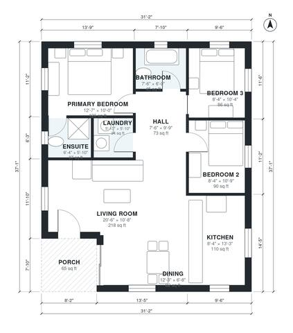

# 1100 Sq Ft ADU Plans: 3 Bed, 2 Bath Detached Backyard Unit

This is a compact single-storey backyard ADU of about 1,150 sq ft overall, with roughly 1,090 sq ft of indoor living space plus a covered front porch. The porch opens into an open kitchen, dining and living area. A central hall leads to three bedrooms, a hall bath, a primary ensuite and a laundry. If you want, we can widen the dining area or add more glazing in the living room.

| | |
|---|---|
| Levels | 1 |
| Footprint | 9.5 m × 11.3 m (31 ft × 37 ft) |
| Rooms | 10 indoor, 1 outdoor |
| Indoor area including garage, from the room grid | about 101 m² (1,091 sq ft) |

## Files here

- `area-schedule.csv` (room schedule)
- `building.json` (rooms, walls, openings as data)
- `plan-level1.dxf` (floor plan, DXF, drawing units: inches)

## More for this plan

- Plan page with the PDF plan set, IFC and 3D model, and a tool to change the plan: https://floorplan.ai-architectures.com/house-plans/1100-sq-ft-adu-plans?utm_source=github-plans&utm_medium=probe&utm_campaign=github
- PDF plan set: https://storage.googleapis.com/20img/house-plans/1100-sq-ft-adu-plans/plan-set.pdf
- IFC model: https://storage.googleapis.com/20img/house-plans/1100-sq-ft-adu-plans/model.ifc

## Known issues in this drawing

- Dining is only 2.04 m wide.

Concept design generated with AI. Not for construction or permit; verify with a licensed professional.
