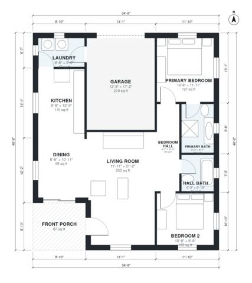

# 1100 Sq Ft House Plans: 2 Bed, 2 Bath with 1-Car Garage

This is a compact single-story 2-bedroom, 2-bath ranch of roughly 100 m² (about 1,100 sq ft) of living space. It also has a front porch and an attached 1-car garage. An open kitchen, dining and living area sits at the front and west of the house, with the laundry between the kitchen and garage. The primary suite and second bedroom share a short hall with the hall bath on the quiet side of the house.

| | |
|---|---|
| Levels | 1 |
| Footprint | 10.6 m × 12.4 m (35 ft × 41 ft) |
| Rooms | 10 indoor, 1 outdoor |
| Indoor area including garage, from the room grid | about 123 m² (1,328 sq ft) |

## Files here

- `area-schedule.csv` (room schedule)
- `building.json` (rooms, walls, openings as data)
- `plan-level1.dxf` (floor plan, DXF, drawing units: inches)

## More for this plan

- Plan page with the PDF plan set, IFC and 3D model, and a tool to change the plan: https://floorplan.ai-architectures.com/house-plans/1100-sq-ft-house-plans?utm_source=github-plans&utm_medium=probe&utm_campaign=github
- PDF plan set: https://storage.googleapis.com/20img/house-plans/1100-sq-ft-house-plans/plan-set.pdf
- IFC model: https://storage.googleapis.com/20img/house-plans/1100-sq-ft-house-plans/model.ifc

## Known issues in this drawing

- None found by the automatic checks.

Concept design generated with AI. Not for construction or permit; verify with a licensed professional.
