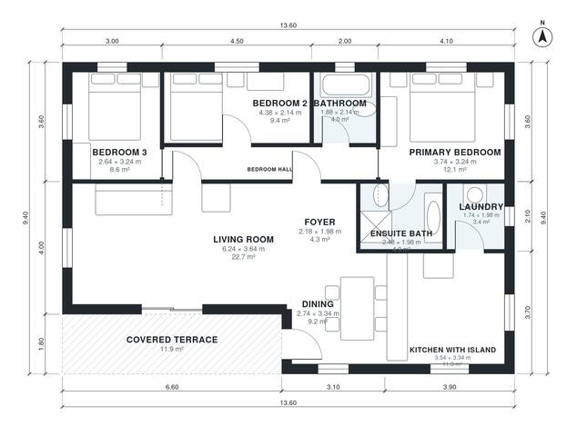

# 120 Square Meter House Plans: 3-Bed, 2-Bath, 1,250 Sq Ft

A compact single-storey home of about 128 m² overall, with roughly 117 m² indoors plus an 11.9 m² covered terrace. It has an open kitchen with island, dining and living area, three bedrooms, a primary ensuite and a shared bath. The laundry opens off the kitchen, and the bedrooms sit together in a quiet wing along the north side. There is no garage.

| | |
|---|---|
| Levels | 1 |
| Footprint | 13.6 m × 9.4 m (45 ft × 31 ft) |
| Rooms | 11 indoor, 1 outdoor |
| Indoor area including garage, from the room grid | about 116 m² (1,248 sq ft) |

## Files here

- `area-schedule.csv` (room schedule)
- `building.json` (rooms, walls, openings as data)
- `plan-level1.dxf` (floor plan, DXF, drawing units: millimetres)

## More for this plan

- Plan page with the PDF plan set, IFC and 3D model, and a tool to change the plan: https://floorplan.ai-architectures.com/house-plans/120-square-meter-house-plans?utm_source=github-plans&utm_medium=probe&utm_campaign=github
- PDF plan set: https://storage.googleapis.com/20img/house-plans/120-square-meter-house-plans/plan-set.pdf
- IFC model: https://storage.googleapis.com/20img/house-plans/120-square-meter-house-plans/model.ifc

## Known issues in this drawing

- Bedroom 2 is only 2.14 m wide.

Concept design generated with AI. Not for construction or permit; verify with a licensed professional.
