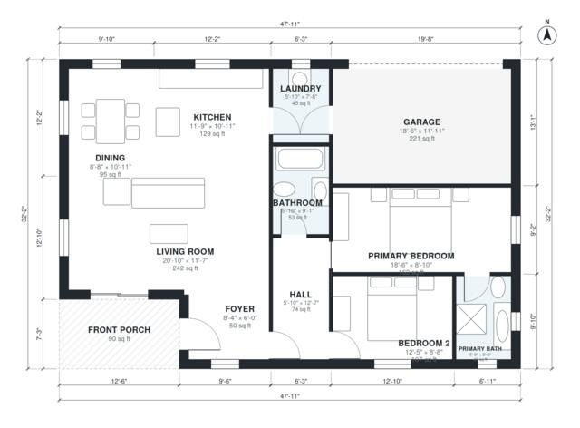

# 1200 Sq Ft 2 Bedroom House Plans: 2 Bath with 1-Car Garage

This is a single-storey ranch of about 112 m² (1,200 sq ft) of living space plus a 22 m² attached 1-car garage and a covered front porch. It has an open kitchen, dining and living area, a laundry room between the kitchen and garage, and two bedrooms off a central hall. The primary suite has its own bath. The primary bedroom is being reshaped to be less narrow.

| | |
|---|---|
| Levels | 1 |
| Footprint | 14.6 m × 9.8 m (48 ft × 32 ft) |
| Rooms | 11 indoor, 1 outdoor |
| Indoor area including garage, from the room grid | about 135 m² (1,450 sq ft) |

## Files here

- `area-schedule.csv` (room schedule)
- `building.json` (rooms, walls, openings as data)
- `plan-level1.dxf` (floor plan, DXF, drawing units: inches)

## More for this plan

- Plan page with the PDF plan set, IFC and 3D model, and a tool to change the plan: https://floorplan.ai-architectures.com/house-plans/1200-sq-ft-2-bedroom-house-plans?utm_source=github-plans&utm_medium=probe&utm_campaign=github
- PDF plan set: https://storage.googleapis.com/20img/house-plans/1200-sq-ft-2-bedroom-house-plans/plan-set.pdf
- IFC model: https://storage.googleapis.com/20img/house-plans/1200-sq-ft-2-bedroom-house-plans/model.ifc

## Known issues in this drawing

- Primary Bedroom is only 2.68 m wide.

Concept design generated with AI. Not for construction or permit; verify with a licensed professional.
