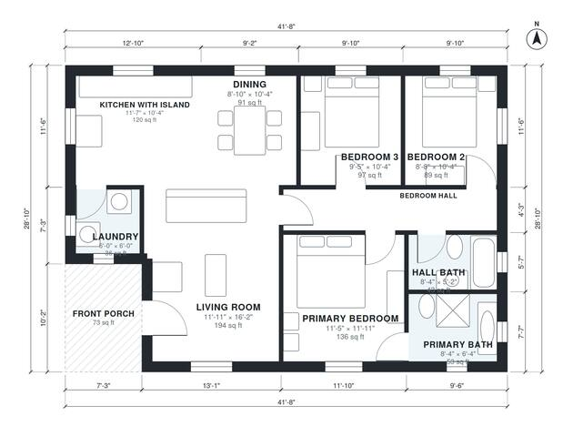

# 1200 Sq Ft 3 Bedroom House Plans: Single-Story, 2 Bath

This single-story home has about 1,200 sq ft of living space (roughly 111 m²) plus a 73 sq ft covered front porch. The open kitchen with island, dining and living area sits at the center. A short hall leads to two secondary bedrooms and a hall bath, and the primary bedroom with its own bath is set apart from them. The laundry is just off the kitchen.

| | |
|---|---|
| Levels | 1 |
| Footprint | 12.7 m × 8.8 m (42 ft × 29 ft) |
| Rooms | 10 indoor, 1 outdoor |
| Indoor area including garage, from the room grid | about 105 m² (1,130 sq ft) |

## Files here

- `area-schedule.csv` (room schedule)
- `building.json` (rooms, walls, openings as data)
- `plan-level1.dxf` (floor plan, DXF, drawing units: inches)

## More for this plan

- Plan page with the PDF plan set, IFC and 3D model, and a tool to change the plan: https://floorplan.ai-architectures.com/house-plans/1200-sq-ft-3-bedroom-house-plans?utm_source=github-plans&utm_medium=probe&utm_campaign=github
- PDF plan set: https://storage.googleapis.com/20img/house-plans/1200-sq-ft-3-bedroom-house-plans/plan-set.pdf
- IFC model: https://storage.googleapis.com/20img/house-plans/1200-sq-ft-3-bedroom-house-plans/model.ifc

## Known issues in this drawing

- Laundry is 3.4 m² (asked for about 5.0 m²).

Concept design generated with AI. Not for construction or permit; verify with a licensed professional.
