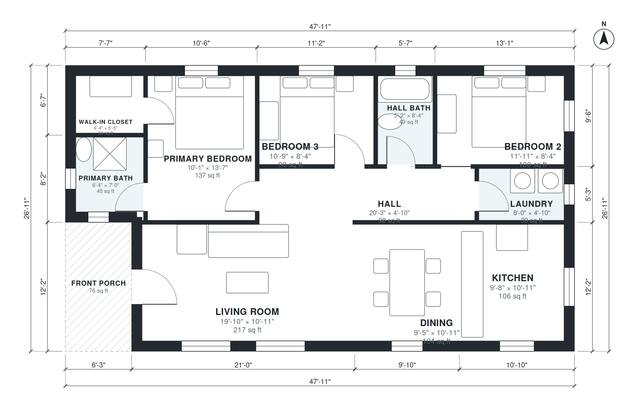

# 1200 Sq Ft ADU Plans: 3 Bed, 2 Bath Detached Backyard Unit

This is a single-storey detached ADU of roughly 1,150 sq ft of conditioned space, plus a 76 sq ft front porch, close to your 1,200 sq ft target. The front porch opens into an open-plan living, dining and kitchen area. A central hall leads to two bedrooms, a shared bath and the laundry, and a primary suite with its own bath and walk-in closet sits at the far end. Bedrooms are on the quieter side of the plan and every room has an exterior window.

| | |
|---|---|
| Levels | 1 |
| Footprint | 14.6 m × 8.2 m (48 ft × 27 ft) |
| Rooms | 11 indoor, 1 outdoor |
| Indoor area including garage, from the room grid | about 113 m² (1,213 sq ft) |

## Files here

- `area-schedule.csv` (room schedule)
- `building.json` (rooms, walls, openings as data)
- `plan-level1.dxf` (floor plan, DXF, drawing units: inches)

## More for this plan

- Plan page with the PDF plan set, IFC and 3D model, and a tool to change the plan: https://floorplan.ai-architectures.com/house-plans/1200-sq-ft-adu-plans?utm_source=github-plans&utm_medium=probe&utm_campaign=github
- PDF plan set: https://storage.googleapis.com/20img/house-plans/1200-sq-ft-adu-plans/plan-set.pdf
- IFC model: https://storage.googleapis.com/20img/house-plans/1200-sq-ft-adu-plans/model.ifc

## Known issues in this drawing

- None found by the automatic checks.

Concept design generated with AI. Not for construction or permit; verify with a licensed professional.
