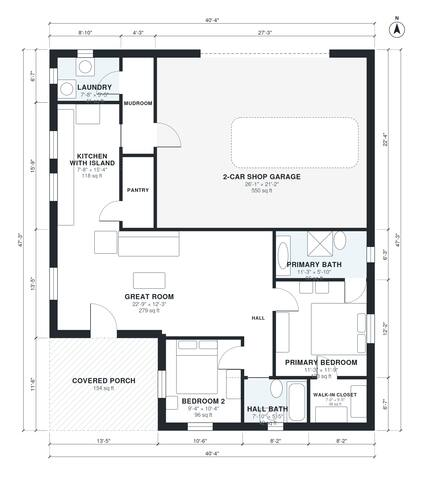

# 1200 Sq Ft Barndominium Floor Plans: 2 Bed, 2 Bath, Shop

A simple rectangular metal-clad barndominium with about 112 m² (1,200 sq ft) of living space plus a 54 m² attached 2-car shop, about 177 m² in total. The open great room and island kitchen sit at the center with a covered front porch. The primary suite with walk-in closet is on one side, and the second bedroom and hall bath are off a short hall. The mudroom and laundry give a practical entry from the shop.

| | |
|---|---|
| Levels | 1 |
| Footprint | 12.3 m × 14.4 m (40 ft × 47 ft) |
| Rooms | 12 indoor, 1 outdoor |
| Indoor area including garage, from the room grid | about 163 m² (1,752 sq ft) |

## Files here

- `area-schedule.csv` (room schedule)
- `building.json` (rooms, walls, openings as data)
- `plan-level1.dxf` (floor plan, DXF, drawing units: inches)

## More for this plan

- Plan page with the PDF plan set, IFC and 3D model, and a tool to change the plan: https://floorplan.ai-architectures.com/house-plans/1200-sq-ft-barndominium-floor-plans?utm_source=github-plans&utm_medium=probe&utm_campaign=github
- PDF plan set: https://storage.googleapis.com/20img/house-plans/1200-sq-ft-barndominium-floor-plans/plan-set.pdf
- IFC model: https://storage.googleapis.com/20img/house-plans/1200-sq-ft-barndominium-floor-plans/model.ifc

## Known issues in this drawing

- Mudroom is only 1.18 m wide.

Concept design generated with AI. Not for construction or permit; verify with a licensed professional.
