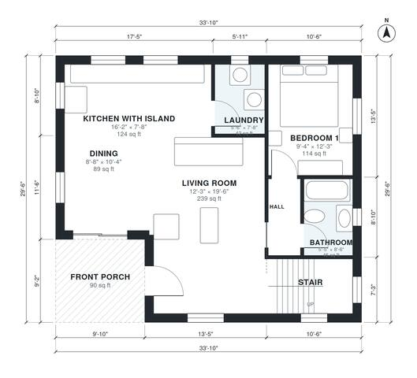

# 1200 Sq Ft Cabin Plans: 2 Bed Story-and-a-Half with Porch

This is a compact rustic cabin of about 112 m² (1,200 sq ft) of living space, plus an 8 m² front porch. The main level has an open kitchen with island, dining and living area, a laundry, the bath and Bedroom 1. A loft above holds a sitting area and Bedroom 2. The layout is efficient, with the stair at the front corner and the bedroom and bath tucked off a small hall.

| | |
|---|---|
| Levels | 2 |
| Footprint | 10.3 m × 9.0 m (34 ft × 30 ft) |
| Rooms | 11 indoor, 2 outdoor |
| Indoor area including garage, from the room grid | about 113 m² (1,217 sq ft) |

## Files here

- `area-schedule.csv` (room schedule)
- `building.json` (rooms, walls, openings as data)
- `plan-level1.dxf` (floor plan, DXF, drawing units: inches)
- `plan-level2.dxf` (floor plan, DXF, drawing units: inches)

## More for this plan

- Plan page with the PDF plan set, IFC and 3D model, and a tool to change the plan: https://floorplan.ai-architectures.com/house-plans/1200-sq-ft-cabin-plans?utm_source=github-plans&utm_medium=probe&utm_campaign=github
- PDF plan set: https://storage.googleapis.com/20img/house-plans/1200-sq-ft-cabin-plans/plan-set.pdf
- IFC model: https://storage.googleapis.com/20img/house-plans/1200-sq-ft-cabin-plans/model.ifc

## Known issues in this drawing

- Bedroom 1 is only 2.84 m wide.

Concept design generated with AI. Not for construction or permit; verify with a licensed professional.
