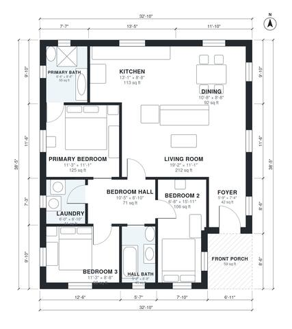

# 1200 Sq Ft House Plans: 3 Bed, 2 Bath Single-Story Plan

This is a single-story, roughly 1,200 sq ft farmhouse-style home with a small front porch. The front door opens through a foyer into an open kitchen, dining and living area. A central hall serves three bedrooms, a primary bath, a hall bath and the laundry, which keeps the bedrooms private and the layout simple.

| | |
|---|---|
| Levels | 1 |
| Footprint | 10.0 m × 11.7 m (33 ft × 38 ft) |
| Rooms | 11 indoor, 1 outdoor |
| Indoor area including garage, from the room grid | about 112 m² (1,201 sq ft) |

## Files here

- `area-schedule.csv` (room schedule)
- `building.json` (rooms, walls, openings as data)
- `plan-level1.dxf` (floor plan, DXF, drawing units: inches)

## More for this plan

- Plan page with the PDF plan set, IFC and 3D model, and a tool to change the plan: https://floorplan.ai-architectures.com/house-plans/1200-sq-ft-house-plans?utm_source=github-plans&utm_medium=probe&utm_campaign=github
- PDF plan set: https://storage.googleapis.com/20img/house-plans/1200-sq-ft-house-plans/plan-set.pdf
- IFC model: https://storage.googleapis.com/20img/house-plans/1200-sq-ft-house-plans/model.ifc

## Known issues in this drawing

- Bedroom 2 is only 2.04 m wide.

Concept design generated with AI. Not for construction or permit; verify with a licensed professional.
