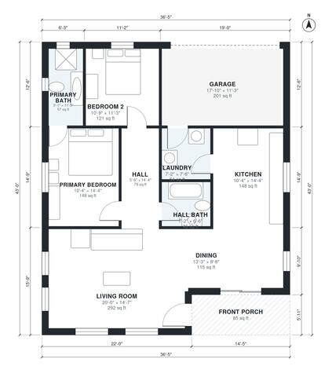

# 1250 Sq Ft House Plans: 2 Bed, 2 Bath One-Story Layout

This is a compact single-story craftsman ranch with about 1,280 sq ft of living space, plus a 1-car garage and a covered front porch. A large open kitchen, dining and living area takes up the west side. The two bedrooms and two baths sit on the east side, and the laundry connects the kitchen to the garage.

| | |
|---|---|
| Levels | 1 |
| Footprint | 11.1 m × 13.1 m (36 ft × 43 ft) |
| Rooms | 10 indoor, 1 outdoor |
| Indoor area including garage, from the room grid | about 137 m² (1,480 sq ft) |

## Files here

- `area-schedule.csv` (room schedule)
- `building.json` (rooms, walls, openings as data)
- `plan-level1.dxf` (floor plan, DXF, drawing units: inches)

## More for this plan

- Plan page with the PDF plan set, IFC and 3D model, and a tool to change the plan: https://floorplan.ai-architectures.com/house-plans/1250-sq-ft-house-plans?utm_source=github-plans&utm_medium=probe&utm_campaign=github
- PDF plan set: https://storage.googleapis.com/20img/house-plans/1250-sq-ft-house-plans/plan-set.pdf
- IFC model: https://storage.googleapis.com/20img/house-plans/1250-sq-ft-house-plans/model.ifc

## Known issues in this drawing

- None found by the automatic checks.

Concept design generated with AI. Not for construction or permit; verify with a licensed professional.
