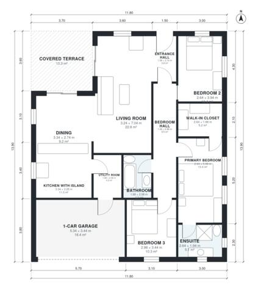

# 130 Square Meter House Plans: 3-Bed, 2-Bath, 1,390 Sq Ft

A single-storey, 3-bedroom, 2-bath house of about 130 m² of living space, plus a 21 m² one-car garage and a 14 m² covered terrace. The kitchen with island, dining and living areas are open-plan and open onto the terrace. The primary suite has an ensuite and a walk-in closet, and the garage connects through the utility room.

| | |
|---|---|
| Levels | 1 |
| Footprint | 11.8 m × 13.9 m (39 ft × 46 ft) |
| Rooms | 13 indoor, 1 outdoor |
| Indoor area including garage, from the room grid | about 151 m² (1,622 sq ft) |

## Files here

- `area-schedule.csv` (room schedule)
- `building.json` (rooms, walls, openings as data)
- `plan-level1.dxf` (floor plan, DXF, drawing units: millimetres)

## More for this plan

- Plan page with the PDF plan set, IFC and 3D model, and a tool to change the plan: https://floorplan.ai-architectures.com/house-plans/130-square-meter-house-plans?utm_source=github-plans&utm_medium=probe&utm_campaign=github
- PDF plan set: https://storage.googleapis.com/20img/house-plans/130-square-meter-house-plans/plan-set.pdf
- IFC model: https://storage.googleapis.com/20img/house-plans/130-square-meter-house-plans/model.ifc

## Known issues in this drawing

- Primary Bedroom is only 2.64 m wide.

Concept design generated with AI. Not for construction or permit; verify with a licensed professional.
