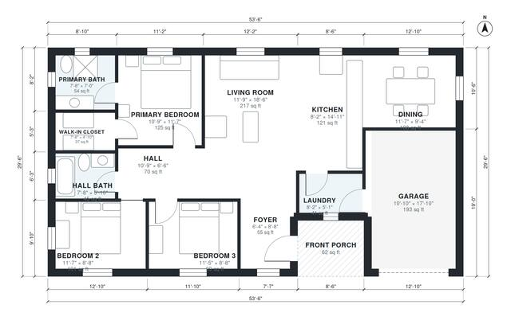

# 1300 Sq Ft House Plans: 3-Bed, 2-Bath Single-Story Layout

This is a single-story 3-bedroom, 2-bath home of about 121 m² (1,300 sq ft) of living space, plus a 1-car garage and a covered front porch. The kitchen, dining and living area is open, and the three bedrooms sit together off a hall on the quiet side. The primary suite has an ensuite and a walk-in closet, and the laundry sits between the kitchen and the garage.

| | |
|---|---|
| Levels | 1 |
| Footprint | 16.3 m × 9.0 m (53 ft × 30 ft) |
| Rooms | 13 indoor, 1 outdoor |
| Indoor area including garage, from the room grid | about 141 m² (1,517 sq ft) |

## Files here

- `area-schedule.csv` (room schedule)
- `building.json` (rooms, walls, openings as data)
- `plan-level1.dxf` (floor plan, DXF, drawing units: inches)

## More for this plan

- Plan page with the PDF plan set, IFC and 3D model, and a tool to change the plan: https://floorplan.ai-architectures.com/house-plans/1300-sq-ft-house-plans?utm_source=github-plans&utm_medium=probe&utm_campaign=github
- PDF plan set: https://storage.googleapis.com/20img/house-plans/1300-sq-ft-house-plans/plan-set.pdf
- IFC model: https://storage.googleapis.com/20img/house-plans/1300-sq-ft-house-plans/model.ifc

## Known issues in this drawing

- None found by the automatic checks.

Concept design generated with AI. Not for construction or permit; verify with a licensed professional.
