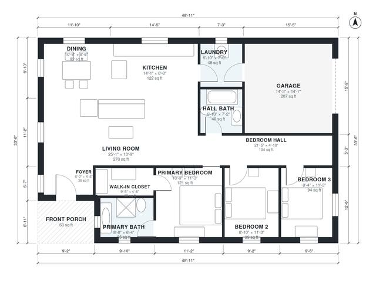

# 1350 Sq Ft House Plans: 3-Bed, 2-Bath One-Story Home Plan

A single-story farmhouse-style home of about 125 m² (1,350 sq ft) of living space. It has a front porch and foyer, an open kitchen, dining and living area, and a 1-car garage that enters through the laundry. The primary suite with ensuite and walk-in closet is at one end of the bedroom hall, with two bedrooms and a shared bath along it. The revised footprint is slightly deeper so the bedrooms and dining area get better proportions.

| | |
|---|---|
| Levels | 1 |
| Footprint | 14.9 m × 10.2 m (49 ft × 33 ft) |
| Rooms | 13 indoor, 1 outdoor |
| Indoor area including garage, from the room grid | about 146 m² (1,573 sq ft) |

## Files here

- `area-schedule.csv` (room schedule)
- `building.json` (rooms, walls, openings as data)
- `plan-level1.dxf` (floor plan, DXF, drawing units: inches)

## More for this plan

- Plan page with the PDF plan set, IFC and 3D model, and a tool to change the plan: https://floorplan.ai-architectures.com/house-plans/1350-sq-ft-house-plans?utm_source=github-plans&utm_medium=probe&utm_campaign=github
- PDF plan set: https://storage.googleapis.com/20img/house-plans/1350-sq-ft-house-plans/plan-set.pdf
- IFC model: https://storage.googleapis.com/20img/house-plans/1350-sq-ft-house-plans/model.ifc

## Known issues in this drawing

- Foyer is 3.3 m² (asked for about 5.0 m²).

Concept design generated with AI. Not for construction or permit; verify with a licensed professional.
