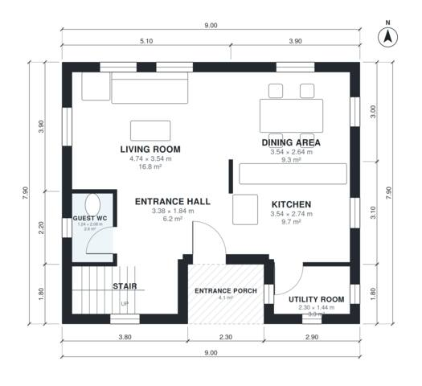

# 140 Square Meter House Plans: 4-Bed Two-Story, 1,490 Sq Ft

This is a compact two-storey home of about 142 m² of living space on a 9.0 x 7.9 m footprint. The ground floor has an open living, dining and kitchen area, a guest WC, a utility room with its own outside door, and a covered entrance porch. Upstairs, a central landing serves four bedrooms and a family bath, and the primary bedroom has its own ensuite.

| | |
|---|---|
| Levels | 2 |
| Footprint | 9.0 m × 7.9 m (30 ft × 26 ft) |
| Rooms | 15 indoor, 1 outdoor |
| Indoor area including garage, from the room grid | about 138 m² (1,486 sq ft) |

## Files here

- `area-schedule.csv` (room schedule)
- `building.json` (rooms, walls, openings as data)
- `plan-level1.dxf` (floor plan, DXF, drawing units: millimetres)
- `plan-level2.dxf` (floor plan, DXF, drawing units: millimetres)

## More for this plan

- Plan page with the PDF plan set, IFC and 3D model, and a tool to change the plan: https://floorplan.ai-architectures.com/house-plans/140-square-meter-house-plans?utm_source=github-plans&utm_medium=probe&utm_campaign=github
- PDF plan set: https://storage.googleapis.com/20img/house-plans/140-square-meter-house-plans/plan-set.pdf
- IFC model: https://storage.googleapis.com/20img/house-plans/140-square-meter-house-plans/model.ifc

## Known issues in this drawing

- Utility Room is 3.3 m² (asked for about 5.0 m²).
- Primary Bedroom is only 2.98 m wide.

Concept design generated with AI. Not for construction or permit; verify with a licensed professional.
