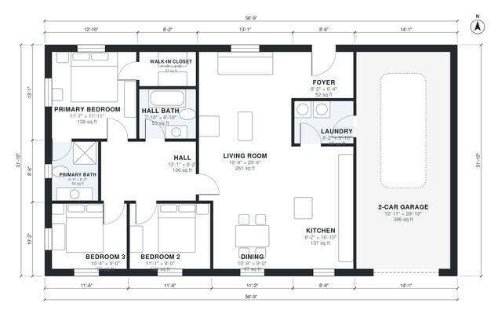

# 1400 Sq Ft 3 Bedroom House Plans: 1,360 Sq Ft Ranch Layout

This is a single-storey ranch of about 130 m² (1,400 sq ft) of living space, plus a 2-car garage of about 35 m². The front door opens into an open kitchen, dining and living area. A central hall leads to three bedrooms and a hall bath, and the primary suite has its own bath and walk-in closet. The garage enters through the laundry.

| | |
|---|---|
| Levels | 1 |
| Footprint | 17.3 m × 9.7 m (57 ft × 32 ft) |
| Rooms | 13 indoor, 0 outdoor |
| Indoor area including garage, from the room grid | about 168 m² (1,806 sq ft) |

## Files here

- `area-schedule.csv` (room schedule)
- `building.json` (rooms, walls, openings as data)
- `plan-level1.dxf` (floor plan, DXF, drawing units: inches)

## More for this plan

- Plan page with the PDF plan set, IFC and 3D model, and a tool to change the plan: https://floorplan.ai-architectures.com/house-plans/1400-sq-ft-3-bedroom-house-plans?utm_source=github-plans&utm_medium=probe&utm_campaign=github
- PDF plan set: https://storage.googleapis.com/20img/house-plans/1400-sq-ft-3-bedroom-house-plans/plan-set.pdf
- IFC model: https://storage.googleapis.com/20img/house-plans/1400-sq-ft-3-bedroom-house-plans/model.ifc

## Known issues in this drawing

- None found by the automatic checks.

Concept design generated with AI. Not for construction or permit; verify with a licensed professional.
