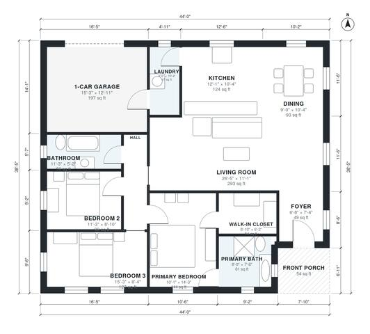

# 1400 Sq Ft House Plans: 3 Bed, 2 Bath Single-Story Design

This is a single-story ranch of about 1,400 sq ft of heated space, plus a 1-car garage and a front porch. It has an open kitchen, dining and living area, a laundry that connects the garage to the kitchen, and a bedroom wing off a single hall. The primary suite has its own bath and walk-in closet, and bedrooms 2 and 3 share a full bath.

| | |
|---|---|
| Levels | 1 |
| Footprint | 13.4 m × 11.7 m (44 ft × 38 ft) |
| Rooms | 13 indoor, 1 outdoor |
| Indoor area including garage, from the room grid | about 152 m² (1,633 sq ft) |

## Files here

- `area-schedule.csv` (room schedule)
- `building.json` (rooms, walls, openings as data)
- `plan-level1.dxf` (floor plan, DXF, drawing units: inches)

## More for this plan

- Plan page with the PDF plan set, IFC and 3D model, and a tool to change the plan: https://floorplan.ai-architectures.com/house-plans/1400-sq-ft-house-plans?utm_source=github-plans&utm_medium=probe&utm_campaign=github
- PDF plan set: https://storage.googleapis.com/20img/house-plans/1400-sq-ft-house-plans/plan-set.pdf
- IFC model: https://storage.googleapis.com/20img/house-plans/1400-sq-ft-house-plans/model.ifc

## Known issues in this drawing

- None found by the automatic checks.

Concept design generated with AI. Not for construction or permit; verify with a licensed professional.
