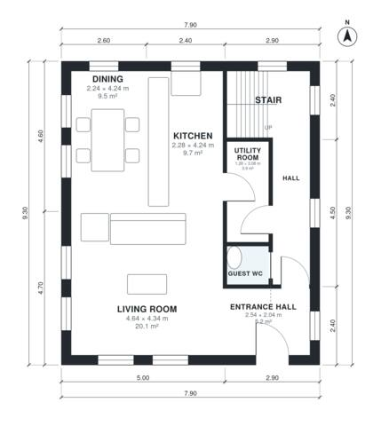

# 150 Square Meter House Plans: 4-Bed, 2-Story, 1,580 Sq Ft

A compact two-storey home of about 148 m² with no garage. The ground floor has an open kitchen, dining and living space, an entrance hall, a guest WC and a utility room. Upstairs are four bedrooms, including a primary with an en-suite, and a family bathroom. Compared with the first draft, the footprint is squarer so the bedrooms, dining area and en-suite get more usable proportions.

| | |
|---|---|
| Levels | 2 |
| Footprint | 7.9 m × 9.3 m (26 ft × 31 ft) |
| Rooms | 16 indoor, 0 outdoor |
| Indoor area including garage, from the room grid | about 147 m² (1,582 sq ft) |

## Files here

- `area-schedule.csv` (room schedule)
- `building.json` (rooms, walls, openings as data)
- `plan-level1.dxf` (floor plan, DXF, drawing units: millimetres)
- `plan-level2.dxf` (floor plan, DXF, drawing units: millimetres)

## More for this plan

- Plan page with the PDF plan set, IFC and 3D model, and a tool to change the plan: https://floorplan.ai-architectures.com/house-plans/150-square-meter-house-plans?utm_source=github-plans&utm_medium=probe&utm_campaign=github
- PDF plan set: https://storage.googleapis.com/20img/house-plans/150-square-meter-house-plans/plan-set.pdf
- IFC model: https://storage.googleapis.com/20img/house-plans/150-square-meter-house-plans/model.ifc

## Known issues in this drawing

- Dining is only 2.24 m wide.

Concept design generated with AI. Not for construction or permit; verify with a licensed professional.
