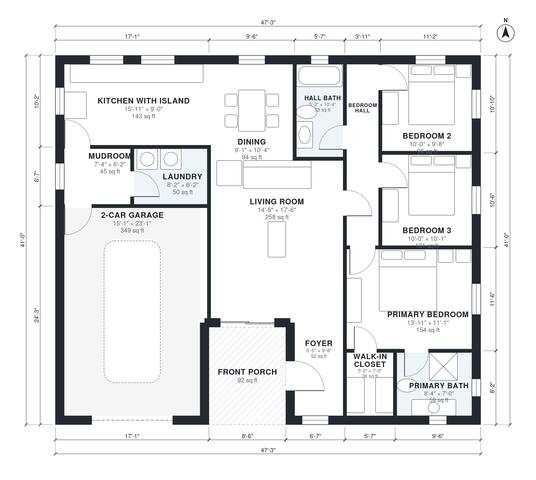

# 1500 Sq Ft 3 Bedroom House Plans: One-Story with Garage

This single-story farmhouse-style plan has about 140 m² (1,500 sq ft) of living space, plus a 2-car garage and a front porch. It has an open kitchen with island, dining and living area, a mudroom and laundry between the kitchen and garage, and three bedrooms. The primary suite has a bath and walk-in closet, and it sits apart from the two secondary bedrooms.

| | |
|---|---|
| Levels | 1 |
| Footprint | 14.4 m × 12.5 m (47 ft × 41 ft) |
| Rooms | 14 indoor, 1 outdoor |
| Indoor area including garage, from the room grid | about 171 m² (1,845 sq ft) |

## Files here

- `area-schedule.csv` (room schedule)
- `building.json` (rooms, walls, openings as data)
- `plan-level1.dxf` (floor plan, DXF, drawing units: inches)

## More for this plan

- Plan page with the PDF plan set, IFC and 3D model, and a tool to change the plan: https://floorplan.ai-architectures.com/house-plans/1500-sq-ft-3-bedroom-house-plans?utm_source=github-plans&utm_medium=probe&utm_campaign=github
- PDF plan set: https://storage.googleapis.com/20img/house-plans/1500-sq-ft-3-bedroom-house-plans/plan-set.pdf
- IFC model: https://storage.googleapis.com/20img/house-plans/1500-sq-ft-3-bedroom-house-plans/model.ifc

## Known issues in this drawing

- None found by the automatic checks.

Concept design generated with AI. Not for construction or permit; verify with a licensed professional.
