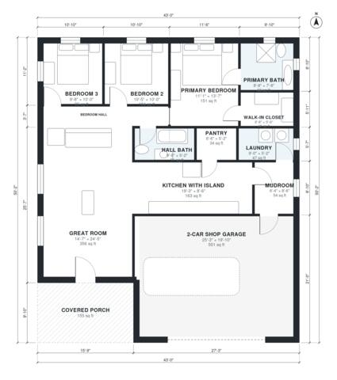

# 1500 Sq Ft Barndominium Floor Plans: 3 Bed, 2 Bath Plan

This is a single-story rectangular barndominium of about 43 ft x 50 ft overall. It has roughly 1,400-1,500 sq ft of living space, plus a 500+ sq ft two-car shop and a covered front porch. An open great room and island kitchen sit at the centre. The three bedrooms line the north wall, with the primary suite and walk-in closet at the east end. The mudroom links the shop, kitchen and laundry.

| | |
|---|---|
| Levels | 1 |
| Footprint | 13.1 m × 15.3 m (43 ft × 50 ft) |
| Rooms | 13 indoor, 1 outdoor |
| Indoor area including garage, from the room grid | about 186 m² (2,002 sq ft) |

## Files here

- `area-schedule.csv` (room schedule)
- `building.json` (rooms, walls, openings as data)
- `plan-level1.dxf` (floor plan, DXF, drawing units: inches)

## More for this plan

- Plan page with the PDF plan set, IFC and 3D model, and a tool to change the plan: https://floorplan.ai-architectures.com/house-plans/1500-sq-ft-barndominium-floor-plans?utm_source=github-plans&utm_medium=probe&utm_campaign=github
- PDF plan set: https://storage.googleapis.com/20img/house-plans/1500-sq-ft-barndominium-floor-plans/plan-set.pdf
- IFC model: https://storage.googleapis.com/20img/house-plans/1500-sq-ft-barndominium-floor-plans/model.ifc

## Known issues in this drawing

- Kitchen with Island has no window.

Concept design generated with AI. Not for construction or permit; verify with a licensed professional.
