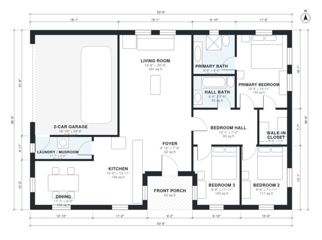

# 1500 sq ft House Plans: 3-Bed Single-Story, 2-Car Garage

This is a single-story home of about 1,550 sq ft of heated space, plus a 2-car garage and a covered front porch. The kitchen, dining and living areas are one open space. The three bedrooms sit together on a quiet side of the house, and the primary suite has a private bath and walk-in closet. Laundry doubles as a mudroom between the garage and the kitchen.

| | |
|---|---|
| Levels | 1 |
| Footprint | 16.3 m × 11.2 m (53 ft × 37 ft) |
| Rooms | 13 indoor, 1 outdoor |
| Indoor area including garage, from the room grid | about 177 m² (1,902 sq ft) |

## Files here

- `building.json` (rooms, walls, openings as data)
- `plan-level1.dxf` (floor plan, DXF, drawing units: inches)

## More for this plan

- Plan page with the PDF plan set, IFC and 3D model, and a tool to change the plan: https://floorplan.ai-architectures.com/house-plans/1500-sq-ft-house-plans?utm_source=github-plans&utm_medium=probe&utm_campaign=github
- PDF plan set: https://storage.googleapis.com/20img/house-plans/1500-sq-ft-house-plans/plan-set.pdf
- IFC model: https://storage.googleapis.com/20img/house-plans/1500-sq-ft-house-plans/model.ifc

## Known issues in this drawing

- None found by the automatic checks.

Concept design generated with AI. Not for construction or permit; verify with a licensed professional.
