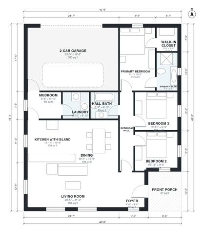

# 1500 Sq Ft Ranch House Plans: 3 Bed, 2 Bath, 2-Car Garage

This is a single-story ranch with about 1,500 sq ft (139 m²) of living space, plus a 2-car garage and a front porch. An open kitchen with an island, dining and living area sits at the front and centre. The three bedrooms and two baths are in a private wing off a hall. The primary suite has an ensuite bath and walk-in closet. The garage enters through a mudroom, which also leads to the laundry.

| | |
|---|---|
| Levels | 1 |
| Footprint | 12.4 m × 14.7 m (41 ft × 48 ft) |
| Rooms | 14 indoor, 1 outdoor |
| Indoor area including garage, from the room grid | about 174 m² (1,875 sq ft) |

## Files here

- `area-schedule.csv` (room schedule)
- `building.json` (rooms, walls, openings as data)
- `plan-level1.dxf` (floor plan, DXF, drawing units: inches)

## More for this plan

- Plan page with the PDF plan set, IFC and 3D model, and a tool to change the plan: https://floorplan.ai-architectures.com/house-plans/1500-sq-ft-ranch-house-plans?utm_source=github-plans&utm_medium=probe&utm_campaign=github
- PDF plan set: https://storage.googleapis.com/20img/house-plans/1500-sq-ft-ranch-house-plans/plan-set.pdf
- IFC model: https://storage.googleapis.com/20img/house-plans/1500-sq-ft-ranch-house-plans/model.ifc

## Known issues in this drawing

- Dining has no window.
- Primary Bedroom is only 2.78 m wide.

Concept design generated with AI. Not for construction or permit; verify with a licensed professional.
