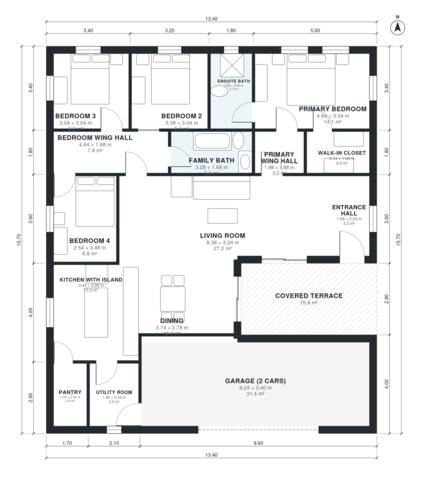

# 160 Square Meter House Plans: 4-Bed Single-Story, 1,680 Sq Ft

A single-storey 4-bedroom house of roughly 165 m² of living space (about 212 m² overall including the 2-car garage and covered terrace). The kitchen with island and pantry opens to the dining and living areas. The primary suite is in its own wing, away from the three secondary bedrooms. The garage enters through the utility room.

| | |
|---|---|
| Levels | 1 |
| Footprint | 13.4 m × 15.7 m (44 ft × 52 ft) |
| Rooms | 16 indoor, 1 outdoor |
| Indoor area including garage, from the room grid | about 194 m² (2,093 sq ft) |

## Files here

- `area-schedule.csv` (room schedule)
- `building.json` (rooms, walls, openings as data)
- `plan-level1.dxf` (floor plan, DXF, drawing units: millimetres)

## More for this plan

- Plan page with the PDF plan set, IFC and 3D model, and a tool to change the plan: https://floorplan.ai-architectures.com/house-plans/160-square-meter-house-plans?utm_source=github-plans&utm_medium=probe&utm_campaign=github
- PDF plan set: https://storage.googleapis.com/20img/house-plans/160-square-meter-house-plans/plan-set.pdf
- IFC model: https://storage.googleapis.com/20img/house-plans/160-square-meter-house-plans/model.ifc

## Known issues in this drawing

- None found by the automatic checks.

Concept design generated with AI. Not for construction or permit; verify with a licensed professional.
