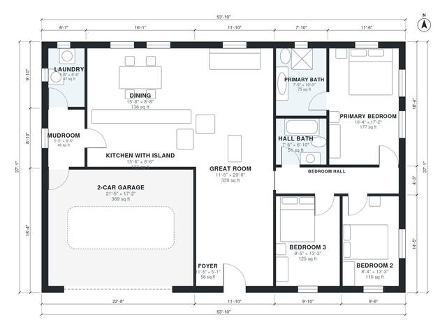

# 1600 Sq Ft 3 Bedroom House Plans: Single-Story with Garage

This is a single-story ranch of about 186 m² overall, with about 146 m² (about 1,570 sq ft) of living space plus a 2-car garage. A large open great room, island kitchen and dining area sit at the front of the house. The primary suite and two bedrooms are grouped on a private bedroom hall, and a mudroom and laundry link the garage to the kitchen.

| | |
|---|---|
| Levels | 1 |
| Footprint | 16.4 m × 11.3 m (54 ft × 37 ft) |
| Rooms | 13 indoor, 0 outdoor |
| Indoor area including garage, from the room grid | about 185 m² (1,995 sq ft) |

## Files here

- `area-schedule.csv` (room schedule)
- `building.json` (rooms, walls, openings as data)
- `plan-level1.dxf` (floor plan, DXF, drawing units: inches)

## More for this plan

- Plan page with the PDF plan set, IFC and 3D model, and a tool to change the plan: https://floorplan.ai-architectures.com/house-plans/1600-sq-ft-3-bedroom-house-plans?utm_source=github-plans&utm_medium=probe&utm_campaign=github
- PDF plan set: https://storage.googleapis.com/20img/house-plans/1600-sq-ft-3-bedroom-house-plans/plan-set.pdf
- IFC model: https://storage.googleapis.com/20img/house-plans/1600-sq-ft-3-bedroom-house-plans/model.ifc

## Known issues in this drawing

- Kitchen with Island is 12.3 m² (asked for about 17.0 m²).
- Kitchen with Island has no window.

Concept design generated with AI. Not for construction or permit; verify with a licensed professional.
