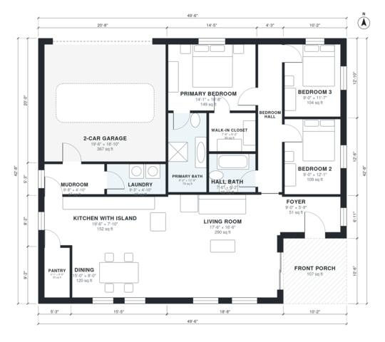

# 1600 Sq Ft Farmhouse Plans: 3-Bed, 2-Bath One-Story Home

This is a single-story modern farmhouse of about 196 m² (2,100 sq ft) overall. It has about 137 m² (1,475 sq ft) of conditioned living space, plus an attached 2-car garage and a front porch. An open kitchen with island, dining and living area sits at the centre. The three bedrooms and two baths are in a separate wing off a short hall, and the primary suite has its own bath and walk-in closet. The garage enters through a mudroom with the laundry beside it.

| | |
|---|---|
| Levels | 1 |
| Footprint | 15.1 m × 13.0 m (50 ft × 43 ft) |
| Rooms | 15 indoor, 1 outdoor |
| Indoor area including garage, from the room grid | about 186 m² (2,006 sq ft) |

## Files here

- `area-schedule.csv` (room schedule)
- `building.json` (rooms, walls, openings as data)
- `plan-level1.dxf` (floor plan, DXF, drawing units: inches)

## More for this plan

- Plan page with the PDF plan set, IFC and 3D model, and a tool to change the plan: https://floorplan.ai-architectures.com/house-plans/1600-sq-ft-farmhouse-plans?utm_source=github-plans&utm_medium=probe&utm_campaign=github
- PDF plan set: https://storage.googleapis.com/20img/house-plans/1600-sq-ft-farmhouse-plans/plan-set.pdf
- IFC model: https://storage.googleapis.com/20img/house-plans/1600-sq-ft-farmhouse-plans/model.ifc

## Known issues in this drawing

- Dining is only 2.44 m wide.

Concept design generated with AI. Not for construction or permit; verify with a licensed professional.
