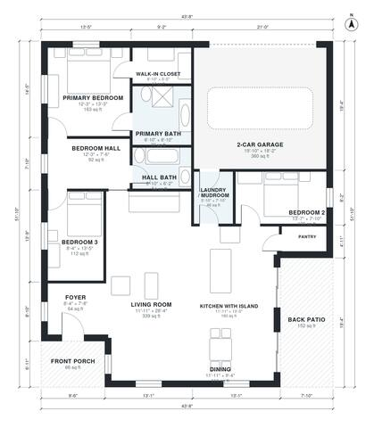

# 1600 Sq Ft House Plans: 3 Bed, 2 Bath Single-Story Layout

A single-story ranch of about 1,580 sq ft of living space (147 m²) plus a 2-car garage, front porch and back patio. The open kitchen with island, dining and living room form one great room that opens to the patio. The three bedrooms are grouped off a private hall, with the primary suite at the far end.

| | |
|---|---|
| Levels | 1 |
| Footprint | 13.3 m × 15.8 m (44 ft × 52 ft) |
| Rooms | 14 indoor, 2 outdoor |
| Indoor area including garage, from the room grid | about 190 m² (2,044 sq ft) |

## Files here

- `area-schedule.csv` (room schedule)
- `building.json` (rooms, walls, openings as data)
- `plan-level1.dxf` (floor plan, DXF, drawing units: inches)

## More for this plan

- Plan page with the PDF plan set, IFC and 3D model, and a tool to change the plan: https://floorplan.ai-architectures.com/house-plans/1600-sq-ft-house-plans?utm_source=github-plans&utm_medium=probe&utm_campaign=github
- PDF plan set: https://storage.googleapis.com/20img/house-plans/1600-sq-ft-house-plans/plan-set.pdf
- IFC model: https://storage.googleapis.com/20img/house-plans/1600-sq-ft-house-plans/model.ifc

## Known issues in this drawing

- Bedroom Hall and Bedroom 2 are not directly connected.
- Bedroom 2 is only 2.38 m wide.

Concept design generated with AI. Not for construction or permit; verify with a licensed professional.
