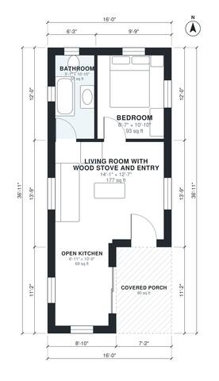

# 16x32 Cabin Floor Plans: 1 Bed, 1 Bath, 510 Sq Ft Layout

A compact rustic cabin of about 47.6 m² (512 sq ft) indoors, plus a covered porch outside the 16 x 32 ft rectangle. The front door opens from the porch into an open living and kitchen area with a wood stove. The single bedroom and the bathroom open off the living area. The small entry becomes a defined arrival zone inside the living room so no space is lost to a narrow vestibule.

| | |
|---|---|
| Levels | 1 |
| Footprint | 4.88 m × 11.25 m (16 ft × 37 ft) |
| Rooms | 4 indoor, 1 outdoor |
| Indoor area including garage, from the room grid | about 47 m² (511 sq ft) |

## Files here

- `area-schedule.csv` (room schedule)
- `building.json` (rooms, walls, openings as data)
- `plan-level1.dxf` (floor plan, DXF, drawing units: inches)

## More for this plan

- Plan page with the PDF plan set, IFC and 3D model, and a tool to change the plan: https://floorplan.ai-architectures.com/house-plans/16x32-cabin-floor-plans?utm_source=github-plans&utm_medium=probe&utm_campaign=github
- PDF plan set: https://storage.googleapis.com/20img/house-plans/16x32-cabin-floor-plans/plan-set.pdf
- IFC model: https://storage.googleapis.com/20img/house-plans/16x32-cabin-floor-plans/model.ifc

## Known issues in this drawing

- Open Kitchen is 6.4 m² (asked for about 9.0 m²).
- Open Kitchen is only 2.10 m wide.
- Living Room with Wood Stove and Entry is 16.4 m² (asked for about 23.1 m²).

Concept design generated with AI. Not for construction or permit; verify with a licensed professional.
