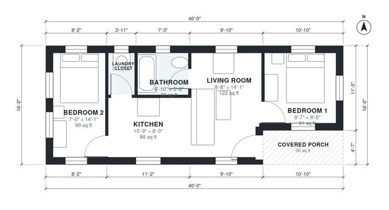

# 16x40 Tiny House Floor Plans: 2 Bed, 1 Bath, 590 Sq Ft

This is a 640 sq ft (59.5 m²) single-storey tiny house on a 16 x 40 ft footprint with a covered front porch, an open kitchen and living area, a shared bath and a laundry closet. In the revised version each bedroom sits at its own end of the house, with the kitchen and living area in the middle. That gives the two sleeping areas the most separation and makes the bedrooms full-depth, usable rooms.

| | |
|---|---|
| Levels | 1 |
| Footprint | 12.19 m × 4.88 m (40 ft × 16 ft) |
| Rooms | 6 indoor, 1 outdoor |
| Indoor area including garage, from the room grid | about 55 m² (591 sq ft) |

## Files here

- `area-schedule.csv` (room schedule)
- `building.json` (rooms, walls, openings as data)
- `plan-level1.dxf` (floor plan, DXF, drawing units: inches)

## More for this plan

- Plan page with the PDF plan set, IFC and 3D model, and a tool to change the plan: https://floorplan.ai-architectures.com/house-plans/16x40-tiny-house-floor-plans?utm_source=github-plans&utm_medium=probe&utm_campaign=github
- PDF plan set: https://storage.googleapis.com/20img/house-plans/16x40-tiny-house-floor-plans/plan-set.pdf
- IFC model: https://storage.googleapis.com/20img/house-plans/16x40-tiny-house-floor-plans/model.ifc

## Known issues in this drawing

- Bedroom 2 is only 2.14 m wide.
- Bedroom 1 is 8.4 m² (asked for about 12.0 m²).

Concept design generated with AI. Not for construction or permit; verify with a licensed professional.
