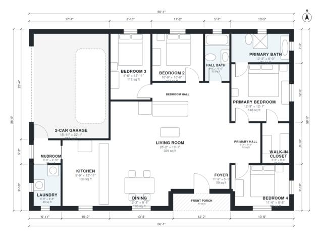

# 1700 Sq Ft 4 Bedroom House Plans: 1,710 Sq Ft Single Story

This is a single-storey contemporary ranch of about 158 m² (1,700 sq ft) of living space, plus an attached 2-car garage. An open kitchen, dining and living area sits in the centre, with a foyer and covered front porch at the entry. Two short halls serve the four bedrooms. The west wing has two bedrooms and a shared bath. The east wing has the primary suite with ensuite and walk-in closet, plus Bedroom 4. The garage enters through a mudroom beside the laundry and kitchen.

| | |
|---|---|
| Levels | 1 |
| Footprint | 17.1 m × 11.7 m (56 ft × 38 ft) |
| Rooms | 16 indoor, 1 outdoor |
| Indoor area including garage, from the room grid | about 196 m² (2,110 sq ft) |

## Files here

- `area-schedule.csv` (room schedule)
- `building.json` (rooms, walls, openings as data)
- `plan-level1.dxf` (floor plan, DXF, drawing units: inches)

## More for this plan

- Plan page with the PDF plan set, IFC and 3D model, and a tool to change the plan: https://floorplan.ai-architectures.com/house-plans/1700-sq-ft-4-bedroom-house-plans?utm_source=github-plans&utm_medium=probe&utm_campaign=github
- PDF plan set: https://storage.googleapis.com/20img/house-plans/1700-sq-ft-4-bedroom-house-plans/plan-set.pdf
- IFC model: https://storage.googleapis.com/20img/house-plans/1700-sq-ft-4-bedroom-house-plans/model.ifc

## Known issues in this drawing

- Living Room has no window.

Concept design generated with AI. Not for construction or permit; verify with a licensed professional.
