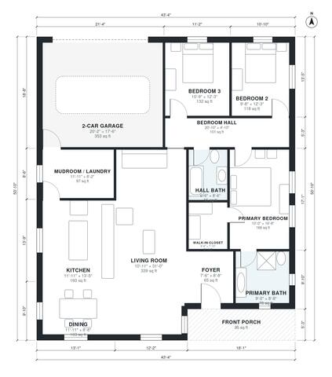

# 1700 Sq Ft House Plans: 3 Bed, 2 Bath Single-Story Design

This single-story farmhouse-style home has about 1,700 sq ft of living space plus a 2-car garage and a covered front porch. The open kitchen, dining and living area sits at the front and west of the plan. The three bedrooms form a private wing along a hall at the back. A mudroom/laundry sits between the garage and kitchen, and the primary suite has an ensuite bath and walk-in closet.

| | |
|---|---|
| Levels | 1 |
| Footprint | 13.2 m × 15.5 m (43 ft × 51 ft) |
| Rooms | 13 indoor, 1 outdoor |
| Indoor area including garage, from the room grid | about 196 m² (2,108 sq ft) |

## Files here

- `area-schedule.csv` (room schedule)
- `building.json` (rooms, walls, openings as data)
- `plan-level1.dxf` (floor plan, DXF, drawing units: inches)

## More for this plan

- Plan page with the PDF plan set, IFC and 3D model, and a tool to change the plan: https://floorplan.ai-architectures.com/house-plans/1700-sq-ft-house-plans?utm_source=github-plans&utm_medium=probe&utm_campaign=github
- PDF plan set: https://storage.googleapis.com/20img/house-plans/1700-sq-ft-house-plans/plan-set.pdf
- IFC model: https://storage.googleapis.com/20img/house-plans/1700-sq-ft-house-plans/model.ifc

## Known issues in this drawing

- None found by the automatic checks.

Concept design generated with AI. Not for construction or permit; verify with a licensed professional.
