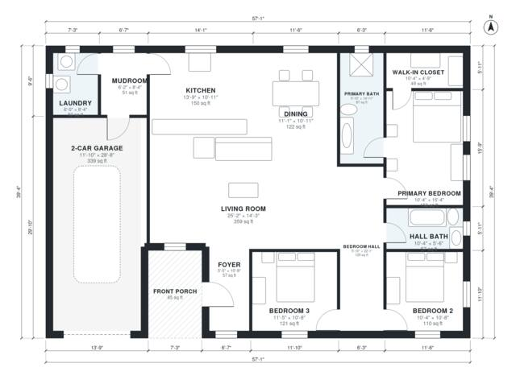

# 1750 Sq Ft House Plans: 3-Bed, 2-Bath Single-Story Design

This is a single-story, 3-bedroom, 2-bath modern farmhouse of about 162 m² (1,750 sq ft) of living space. It has an attached 2-car garage and a front porch on top of that. A large open kitchen, dining and living area sits at the centre. The garage enters through a mudroom with a laundry beside it, and the primary suite with its bath and walk-in closet is on the west side, apart from the two other bedrooms.

| | |
|---|---|
| Levels | 1 |
| Footprint | 17.4 m × 12.0 m (57 ft × 39 ft) |
| Rooms | 14 indoor, 1 outdoor |
| Indoor area including garage, from the room grid | about 201 m² (2,162 sq ft) |

## Files here

- `area-schedule.csv` (room schedule)
- `building.json` (rooms, walls, openings as data)
- `plan-level1.dxf` (floor plan, DXF, drawing units: inches)

## More for this plan

- Plan page with the PDF plan set, IFC and 3D model, and a tool to change the plan: https://floorplan.ai-architectures.com/house-plans/1750-sq-ft-house-plans?utm_source=github-plans&utm_medium=probe&utm_campaign=github
- PDF plan set: https://storage.googleapis.com/20img/house-plans/1750-sq-ft-house-plans/plan-set.pdf
- IFC model: https://storage.googleapis.com/20img/house-plans/1750-sq-ft-house-plans/model.ifc

## Known issues in this drawing

- None found by the automatic checks.

Concept design generated with AI. Not for construction or permit; verify with a licensed professional.
