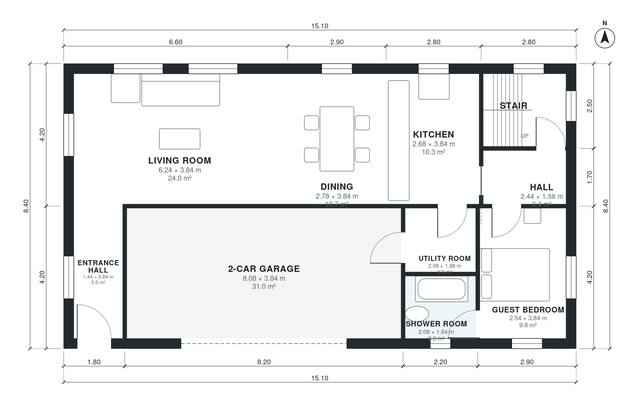

# 180 Square Meter House Plans: 4 Bed, 3 Bath, 2-Car Garage

A compact two-storey house of about 178 m² of living space on a 15.1 x 8.4 m footprint, plus an attached 2-car garage. The ground floor has an open kitchen, dining and living area, a utility room, and a guest bedroom with a shower room. Upstairs are the primary suite with a dressing room and bathroom, two more bedrooms and a family bathroom.

| | |
|---|---|
| Levels | 2 |
| Footprint | 15.1 m × 8.4 m (50 ft × 28 ft) |
| Rooms | 18 indoor, 1 outdoor |
| Indoor area including garage, from the room grid | about 217 m² (2,333 sq ft) |

## Files here

- `area-schedule.csv` (room schedule)
- `building.json` (rooms, walls, openings as data)
- `plan-level1.dxf` (floor plan, DXF, drawing units: millimetres)
- `plan-level2.dxf` (floor plan, DXF, drawing units: millimetres)

## More for this plan

- Plan page with the PDF plan set, IFC and 3D model, and a tool to change the plan: https://floorplan.ai-architectures.com/house-plans/180-square-meter-house-plans?utm_source=github-plans&utm_medium=probe&utm_campaign=github
- PDF plan set: https://storage.googleapis.com/20img/house-plans/180-square-meter-house-plans/plan-set.pdf
- IFC model: https://storage.googleapis.com/20img/house-plans/180-square-meter-house-plans/model.ifc

## Known issues in this drawing

- Entrance Hall and Hall are not directly connected.
- Bedroom 3 is only 2.44 m wide.

Concept design generated with AI. Not for construction or permit; verify with a licensed professional.
